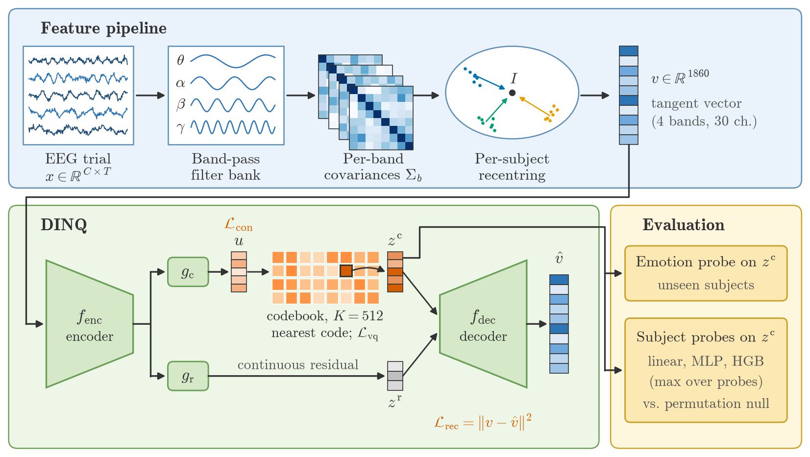

# DINQ: Making subject identity unrepresentable in EEG emotion recognition through neural quantization

Code and derived results for the paper submitted to *Biomedical Signal Processing and
Control*. DINQ (decoupling identity via neural quantization) recentres band-wise EEG
covariances per subject, maps them to the tangent space, and passes them through a
vector-quantized content code `z_c` plus a continuous residual `z_r`. A finite codebook
cannot index the continuous manifold of individual variation, so subject identity is
pushed into the residual while emotion stays in `z_c`. Invariance is certified with a
probe suite (linear, MLP, gradient-boosted trees; max over probes) against a
permutation null.



> Citation: to be added on acceptance.

## Layout

```
dinq/          the package
  data/        DEAP, SEED-V and FACED loaders, common montage, labels, splits
  features/    band-pass filter bank, Ledoit-Wolf covariances, recentring, tangent space, DE
  models/      minimal_dinq.py (encoder -> VQ/FSQ z_c + residual z_r -> decoder)
  losses/      supervised contrastive loss
  eval/        probe certificate, cross-subject recoverability, permutation nulls
  baselines/   reference encoders (random, task-only, MMD, GRL); SCMM adapter
configs/       Hydra feature configs and frozen decision thresholds
scripts/       every experiment, plus make_paper_figures.py
results/       derived per-cell JSON results behind every figure and table
paper/         generated figures (PDF/SVG) and tables (CSV/TeX)
docs/          data cards for the three corpora
```

## Setup

Python 3.11. Install PyTorch with the CUDA wheel for your system, then the rest:

```bash
pip install torch --index-url https://download.pytorch.org/whl/cu121
pip install -r requirements.txt
```

**Probe framework.** The certificate reuses the diagnostic framework from our
companion study (MIT licence). Clone it next to this repository, or point
`DINQ_PAPER1_REPO` at a clone:

```bash
git clone https://github.com/ksimran/Diagnosing-Domain-Adaptation-Failures-in-EEG-Representations.git ../Diagnosing-Domain-Adaptation-Failures-in-EEG-Representations
```

**SCMM baseline (optional).** SCMM's source is not redistributed; see
`dinq/baselines/scmm_vendor/README.md`. Only `scripts/run_baselines.py` needs it.

## Data

FACED, SEED-V and DEAP are available from their original providers under their own
access agreements and are not included here. Place them under one root and set
`DINQ_DATA_ROOT` (default `./data`), or set each path individually; see
`dinq/paths.py`:

| Variable | Default under `DINQ_DATA_ROOT` |
|---|---|
| `DINQ_DEAP_ROOT` | `DEAP_dataset/` (`data_preprocessed_python`, `.dat`) |
| `DINQ_SEEDV_DE_ROOT`, `DINQ_SEEDV_RAW_ROOT`, `DINQ_SEEDV_META_ROOT` | `SEED_V/EEG_DE_features/`, `SEED_V/EEG_raw/`, `SEED_V/` |
| `DINQ_FACED_ROOT`, `DINQ_FACED_CLISA_ZIP` | `Faced/`, `Faced/Clisa_data.zip` |

Extracted features go to `cache/` (`DINQ_CACHE_ROOT`), which is not tracked.

## Regenerating the figures and tables (no data needed)

Every figure and table in `paper/` is rebuilt from the JSON files in `results/`:

```bash
python scripts/make_paper_figures.py
```

## Reproducing the experiments

All FACED results use 8 subject partitions (92 training / 31 held-out subjects),
60 epochs and at most 8000 windows per recoverability probe.

```bash
# 1. Features
python scripts/build_faced.py                                   # FACED covariance + recentred tangent + DE
python scripts/build_features.py                                # DEAP + SEED-V DE
python scripts/build_features.py features=covariance            # DEAP + SEED-V covariances

# 2. FACED subject-axis baselines            -> results/baselines_faced_subject
python scripts/subject_baselines.py --corpus faced --out results/baselines_faced_subject \
  --baselines recentering,random,task_only,grl_subject,mmd --splits 8 --epochs 60 \
  --test-frac 0.25 --cap 8000 --gpus 0,1

# 3. DINQ (vq512_conU) + stabilised permutation null   -> results/faced_permtest
#    --force: without it the shipped split*.json are reused and nothing runs. The z_c files
#    (zc_split*.npz) are not distributed, so each split is retrained and its z_c saved for step 3b.
python scripts/faced_permtest.py --n-perm 125 --gpus 0,1 --metric max --force
python scripts/faced_epochs_check.py         # 3b. emotion on the saved z_c -> results/faced_epochs_check
python scripts/faced_paired_stats.py         # paired tests reported in the paper

# 4. Continuous-bottleneck ablation          -> results/dinq_sweep_faced (continuous cells)
python scripts/dinq_sweep.py --corpus faced --out results/dinq_sweep_faced --configs continuous \
  --splits 8 --epochs 60 --test-frac 0.25 --cap 8000 --n-perm 20 --gpus 0,1

# 5. Codebook configurations on FACED        -> results/codebook_sweep_faced
python scripts/dinq_sweep.py --corpus faced --configs vq128,vq256,vq512,vq1024,fsq512,vq512_conU \
  --splits 8 --epochs 60 --cap 8000 --n-perm 15 --test-frac 0.25 --gpus 0,1 \
  --out results/codebook_sweep_faced

# 6. Task floor (emotion permutation null)   -> configs/thresholds_faced.yaml
python scripts/faced_declare.py --config vq512_conU --floor-splits 8 --n-perm 30

# 7. Cross-dataset transfer                  -> results/cross_corpus
python scripts/cross_corpus_sweep.py --gpus 0,1 --epochs 60 --n-perm 30 --seed 0

# 8. Cross-dataset reference baselines       -> results/baselines_recentered (needs SCMM files)
#    The first covariance run also builds the DEAP/SEED-V recentred tangent caches.
python scripts/run_baselines.py --input covariance --gpus 0,1 --models random,task_only,mmd,grl \
  --ref-epochs 60 --n-block 200 --cap 6000 --seeds 0 --out results/baselines_recentered
python scripts/run_baselines.py --input de --gpus 0,1 --models scmm,random,task_only,mmd,grl \
  --epochs 200 --ref-epochs 60 --n-block 200 --cap 6000 --seeds 0 --out results/baselines_recentered

# 9. SEED-V codebook sweep (operating-point selection) -> results/dinq_sweep
python scripts/dinq_sweep.py --corpus seedv --splits 4 --epochs 50 --n-perm 15 --gpus 0,1 \
  --out results/dinq_sweep
```

`dinq_sweep.py` seeds each cell with its split index and writes the run settings
(epochs, cap, permutations, seed, git revision) into each cell's JSON. GPU
nondeterminism in the codebook updates means re-runs agree closely but not bit for
bit.

**Archived cells.** `results/dinq_sweep_faced/cells/vq512_conU__*` and `vq1024__*`
come from an earlier 80-epoch run with up to 12000 probe windows. The paper does not
use them. They are kept for the record, and `faced_paired_stats.py` reports the
earlier comparison from them. `results/baselines/` holds the cross-dataset baselines
from before per-subject recentring became part of the pipeline; it is superseded by
`results/baselines_recentered/`.


## Licence

Released under the MIT licence (see `LICENSE`). The FACED, SEED-V and DEAP datasets
keep their original access agreements; this repository does not redistribute them or
any features derived from them. The optional SCMM source files are not covered by
this licence and are not included.
